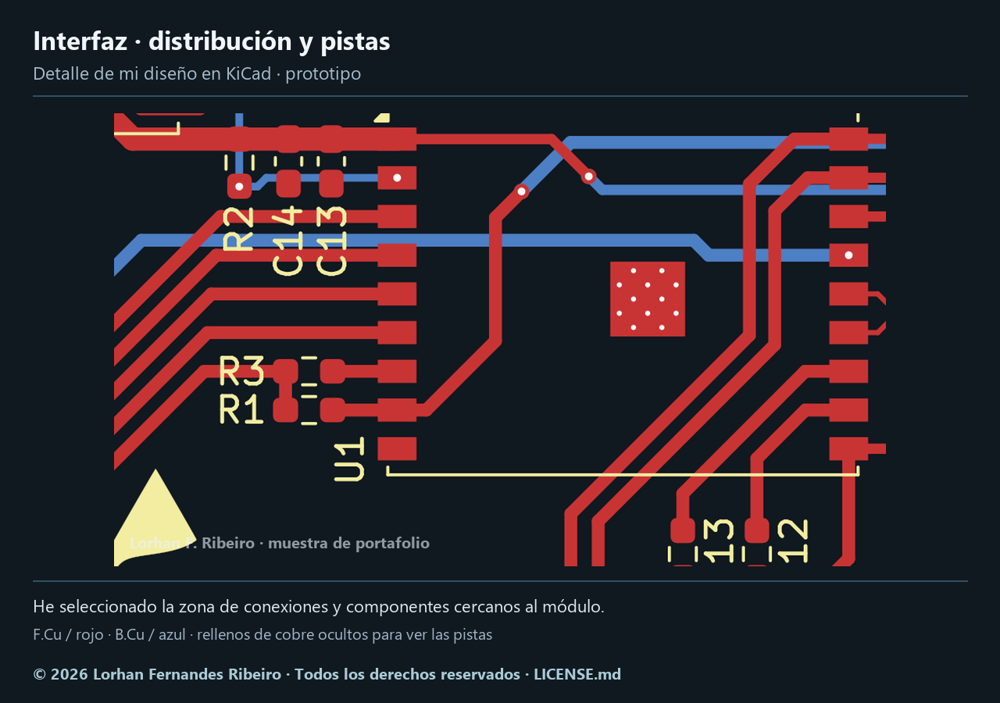
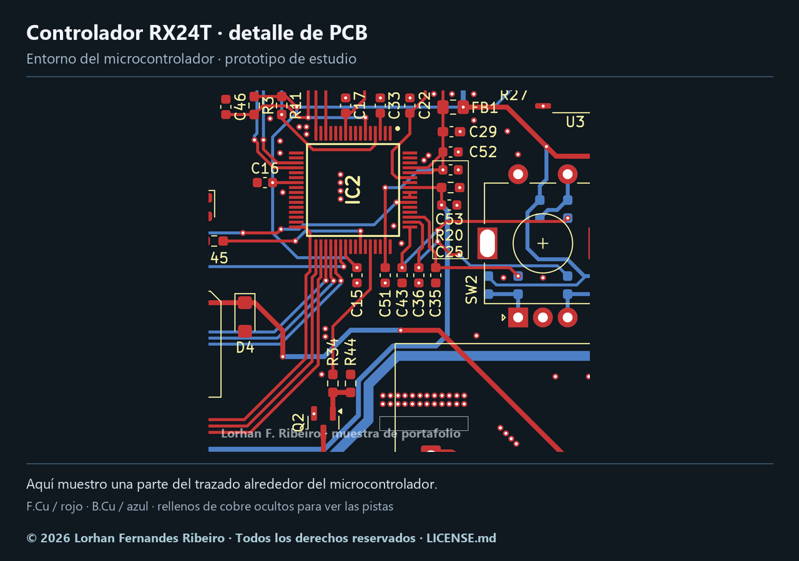

# Algunos detalles de mi trabajo

He elegido dos fragmentos de firmware y dos recortes de PCB para mostrar cómo organizo algunas partes de mis proyectos.

## Firmware

### Animación de un menú OLED en C

En este fragmento calculo el desplazamiento a partir del tiempo transcurrido y redibujo el fotograma cuando cambia su posición. Pertenece a la tarea de pantalla de mi multisimulador y utiliza la base de tiempo de STM32 HAL.

[Ver el fragmento comentado](menu-oled.c)

### Ajuste de valores a una pantalla TFT

En mi interfaz con ESP32 y Arduino, pruebo cuántos decimales caben en el espacio disponible. La función devuelve si el texto cabe, para que el código que la llama pueda decidir cómo presentarlo.

[Ver el fragmento comentado](ajuste-texto-tft.cpp)

Son extractos del código que utilizo en esos proyectos. He añadido comentarios para facilitar su lectura; requieren el contexto y las dependencias de cada aplicación.

## Diseño de PCB con KiCad

### Interfaz: distribución y conexiones

He seleccionado una región de mi placa de interfaz para mostrar la distribución de componentes y el recorrido de algunas pistas. Este diseño de PCB es un prototipo; lo presento por separado del fragmento de firmware anterior.

### Controlador RX24T: entorno del microcontrolador

En este recorte muestro parte del trazado alrededor del microcontrolador de mi prototipo de estudio. Los rellenos de cobre están ocultos en ambas imágenes para que se distingan las pistas.

© 2026 Lorhan Fernandes Ribeiro · [Condiciones de uso](../LICENSE.md)

[Volver a mis proyectos](../README.md)
